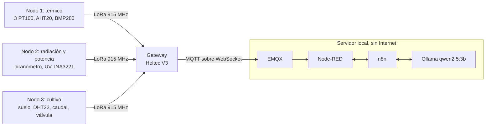
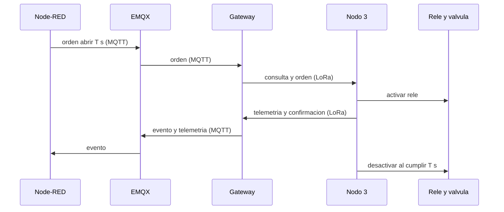

# Sistema IoT agrivoltaico en el borde (LoRa + MQTT + IA local)

Proyecto de la asignatura **Optativa II – Aplicaciones de las Telecomunicaciones (IoT), 2026-2**, Universidad de San Buenaventura, Bogotá.
Autores: Santiago Jiménez Rodríguez y David Santiago Torres Páez.

Sistema que monitorea un panel solar y un cultivo, y gestiona el riego **sin servicios en la nube**: tres nodos de campo y un gateway (Heltec WiFi LoRa 32 V3) se comunican por LoRa; un servidor local (EMQX, Node-RED, n8n y Ollama con `qwen2.5:3b`) recibe, muestra, almacena y analiza los datos.

- **Repositorio:** `https://github.com/<USUARIO>/<REPOSITORIO>`  <!-- reemplazar -->
- **Versión evaluada en el informe:** etiqueta `v1.0-informe`

## Arquitectura

Secuencia de una orden de riego (control determinista):

## Jerarquía de carpetas y relación con el informe

| Carpeta | Contenido | Parte del proyecto |
|---|---|---|
| `firmware/` | Proyecto PlatformIO: un `nodo.cpp` para los tres nodos (según `NODE_ID`), `gateway.cpp`, definición de pines y tramas (`include/`) y programas de prueba por grupo de sensores (`src/tests/`) | Capa de campo y gateway (Fig. 1); enlace LoRa y secuencia de órdenes (Fig. 2) |
| `nodered/` | Flujo único con cuatro pestañas: ingesta y archivos, riego, dashboard, endpoints de IA | Servidor local, regla determinista (Fig. 3, capa determinista) y dashboard |
| `n8n/` | Flujo del asesor de IA (pide resumen de 24 h, consulta a Ollama, devuelve el diagnóstico) | Capa predictiva (Fig. 3) |
| `docs/` | Mapa de pines, formato de tramas, tópicos MQTT, guía de verificación y fotos del montaje | Tablas de interfaces y evidencias |
| `datos_ejemplo/` | Muestra de los archivos CSV y JSON que genera el sistema | Resultados y análisis |
| `informe/` | Fuentes LaTeX del informe final y bibliografía | Documento entregable |

## Requisitos

- **Hardware:** 4 placas Heltec WiFi LoRa 32 V3 y los sensores y actuadores descritos en `docs/mapa_pines.md`.
- **Software:** VS Code con PlatformIO; EMQX con un *listener* de MQTT sobre WebSocket (puerto 8083 en nuestra instalación); Node-RED con el paquete `@flowfuse/node-red-dashboard`; n8n; Ollama con el modelo `qwen2.5:3b`. Versiones usadas (Windows 11, Node-RED 5.0.4, EMQX 5.3.0, n8n 2.34.6 y otras): ver `docs/versiones.md`; las librerías del firmware están fijadas en `firmware/platformio.ini`.

## Cómo ejecutar y verificar

1. **Firmware.** Copie `firmware/include/secrets.h.example` como `firmware/include/secrets.h` y complete su red y la IP del broker (este archivo no se sube a Git). Con una sola placa conectada, compile y cargue cada entorno de PlatformIO: `nodo1`, `nodo2`, `nodo3` y `gateway`.
2. **Pruebas de banco (opcional).** Los entornos `t_*` verifican cada grupo de sensores por separado; la salida esperada de cada uno está en `docs/verificacion.md`.
3. **Broker.** Inicie EMQX y compruebe que el *listener* de WebSocket está activo.
4. **Node-RED.** Instale el paquete del dashboard, importe `nodered/flujo_agrivoltaico.json` (reemplazando nodos existentes), ajuste la dirección del broker en el nodo de configuración y despliegue. El dashboard queda en la ruta `/dashboard` de Node-RED.
5. **Asesor de IA.** Instale Ollama y descargue `qwen2.5:3b`; importe `n8n/asesor_ia.json` en n8n y ejecútelo a mano (usa datos de ejemplo); después actívelo.
6. **Resultado esperado.** El monitor serie del gateway muestra un JSON por nodo cada unos 10 s, el dashboard muestra las variables de los tres nodos y se crean los archivos CSV y JSON en la carpeta de datos configurada en Node-RED.

## Seguridad y privacidad

Las credenciales y direcciones de red **no están en el repositorio** (`secrets.h` está en `.gitignore`). En el prototipo el broker no exige autenticación y las tramas LoRa no están cifradas; esto se declara como limitación en el informe.

## Licencia

Código bajo licencia MIT (ver `LICENSE`). El modelo Qwen2.5 y las librerías de terceros se rigen por sus propias licencias.
